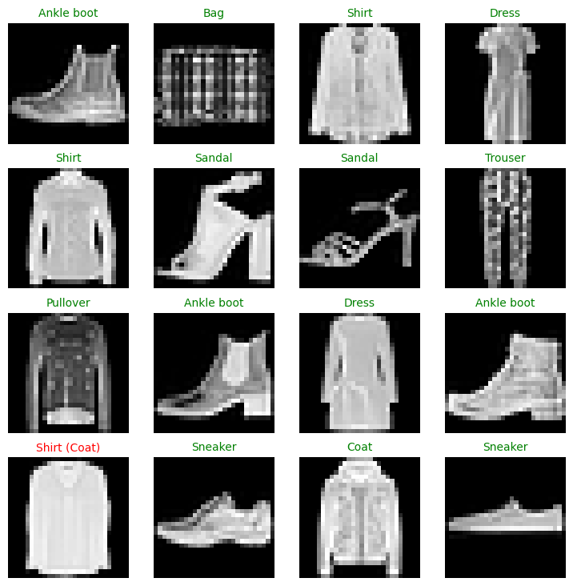
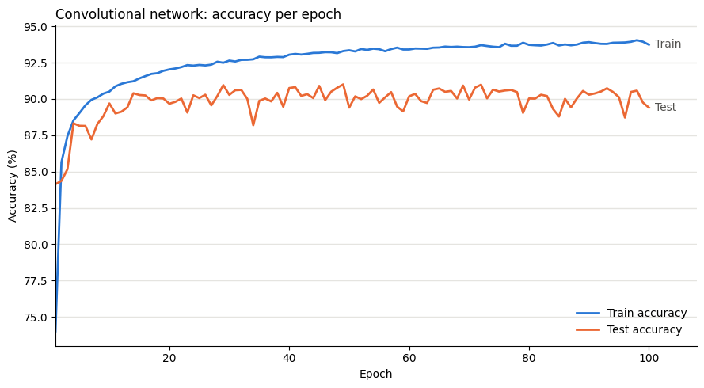

# FashionMNIST Classification

Image classification on the FashionMNIST dataset (70,000 greyscale 28×28 images across 10 clothing categories) with PyTorch.



*Predictions of the convolutional model on random test images. Green: correct. Red: wrong, with the true label in brackets.*

## What's inside

`fashion_mnist_classification.ipynb` covers the full workflow:

- loading the dataset and building `DataLoader`s (batch size 64)
- a fully connected baseline (`FashionMNISTModelV0`: flatten, then two hidden layers of 10 units)
- a convolutional network (`FashionMNISTModelV1`: two blocks of two 3×3 convolutions and a max pooling, then a linear classifier)
- training with `CrossEntropyLoss` and SGD (learning rate 0.1), with the loss and accuracy measured on the test set after every epoch

## Results

Accuracy on the 10,000 test images, which are never used for training:

| Model | Epochs | Train accuracy | Test accuracy |
|---|---|---|---|
| Fully connected baseline | 3 | 83.10% | 81.54% |
| Convolutional network | 100 | 93.73% | 89.40% |



Both accuracies rise quickly over the first epochs. The test accuracy then settles around 90%, while the training accuracy keeps climbing slowly.

Training the convolutional network takes about 6 minutes on an Apple Silicon GPU (MPS).

## Installation

```bash
python -m venv .venv
source .venv/bin/activate
pip install torch torchvision matplotlib jupyter
```

The notebook uses an Apple Silicon GPU (MPS) or an NVIDIA GPU (CUDA) when available, and the CPU otherwise. The dataset is downloaded automatically by `torchvision` into `data/` on the first run.
